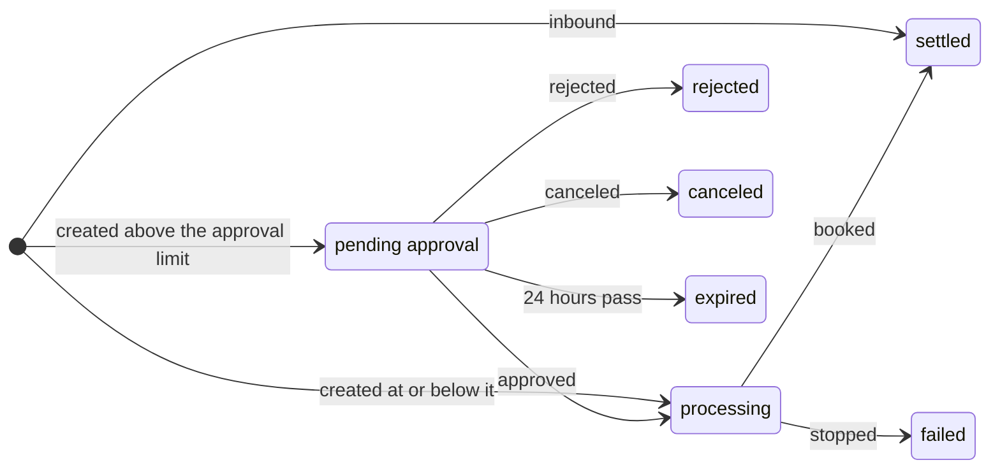

# Domain model

The platform keeps accounts for companies and moves money between them in real time. A company pays other accounts of the platform directly, and accounts at other institutions through a clearing network. Every movement of money is booked on a double-entry ledger.

This document is the source for the contracts in [`contracts/`](../contracts/README.md) and for the tests. Every rule has an ID, such as `LED-5`, so that a contract, a test and a report can name the rule that they are about.

The rules are modeled on [Pix](https://www.bcb.gov.br/en/financialstability/pix_en), the instant payment scheme of the Central Bank of Brazil. The names are generic. The [last section](#what-comes-from-pix) says which idea comes from where.

## Glossary

| Term | Meaning |
|---|---|
| Customer | A company that holds accounts on the platform. |
| User | A person who acts for one customer. |
| Maker | A user who may create payments. |
| Checker | A user who may approve or reject payments. |
| Account | Money of one customer, in one currency. |
| Account number | What a payer needs to pay an account of the platform. |
| Ledger | The record of every movement of money, kept by double entry. |
| Ledger transaction | Two or more entries that are booked together and that balance. |
| Entry | One debit or one credit on one account. |
| Booked balance | The credits of an account minus its debits. |
| Hold | A part of the booked balance that is reserved for one payment. |
| Available balance | The booked balance minus the open holds. |
| House account | An account of the platform itself, in the same ledger. |
| Payment | An instruction to move an amount from a payer to a payee. |
| Payer, payee | The account that pays, and the one that is paid. |
| Clearing network | The system outside the platform that carries payments between participants and settles them. |
| Participant | An institution on the clearing network. The platform is one. |
| Alias | A name that the clearing network resolves to an account at a participant. |
| End-to-end ID | The identifier that a payment keeps at every participant. |
| Fee | What the platform charges for a payment. |
| Limit | A cap on what an account pays out: per payment, per day and per night. |
| Approval limit | The amount above which a payment needs a checker. |
| Idempotency key | A value that a client sends with a request, so that a repeat of the request does nothing new. |
| Correlation ID | A value that travels with a request through every service that it reaches. |
| Audit event | The record of one thing that happened to a payment. |

## Actors

| Actor | What it does |
|---|---|
| Maker | Creates payments for their customer, and cancels their own payments while those wait for approval. |
| Checker | Approves or rejects the payments of their customer that wait for approval. |
| Clearing network | Resolves aliases, settles outbound payments and delivers inbound ones. |

Every user reads the accounts and the payments of their customer. The platform has no bank staff, and no actor opens a customer, a user or an account: see `CUS-5`.

## Rules

Two words have a fixed meaning in the rules.

- **Refused**: a request is turned down. Nothing is created, and nothing changes.
- **Failed**: a payment exists and has ended without moving money.

[ADR 0008](adr/0008-two-services-and-a-simulator-of-the-clearing-network.md) says which service owns which rules.

### Money

| ID | Rule |
|---|---|
| MON-1 | The only currency is the Brazilian real, BRL. |
| MON-2 | An amount is a whole number of centavos. One real is 100 centavos. |
| MON-3 | The platform never rounds an amount that it receives. An amount with a fraction of a centavo is refused. |
| MON-4 | The amount of a payment is greater than zero. |

### Customers and users

| ID | Rule |
|---|---|
| CUS-1 | A customer is a company. It holds one or more accounts. |
| CUS-2 | A user acts for exactly one customer. |
| CUS-3 | A user is a maker, a checker, or both. |
| CUS-4 | A user reads and changes only what belongs to their customer. To a user, the accounts and the payments of another customer do not exist. |
| CUS-5 | Onboarding is outside the platform: no operation creates a customer, a user or an account. In this repository a test seeds them. |

### Accounts and the ledger

| ID | Rule |
|---|---|
| LED-1 | Money moves only by a ledger transaction. It has two or more entries, and its debits equal its credits. |
| LED-2 | An entry is never changed and never deleted. A new ledger transaction corrects a wrong one. |
| LED-3 | The booked balance of an account is the sum of its credits minus the sum of its debits. |
| LED-4 | A hold reserves an amount of one account for one payment. The available balance is the booked balance minus the open holds. |
| LED-5 | The available balance of a customer account is never negative. A hold or a debit that would make it negative is refused. |
| LED-6 | A hold ends once: the ledger transaction of its payment captures it, or it is released. |
| LED-7 | For one payment there is at most one hold and at most one ledger transaction. Asking for either a second time changes nothing. |
| LED-8 | The platform has two house accounts. The settlement account mirrors the money that the platform holds at the clearing network. The fee account collects the fees. |

### Payments

| ID | Rule |
|---|---|
| PAY-1 | A payment moves an amount from one payer account to one payee. |
| PAY-2 | There are three kinds. An internal payment pays an account of the platform, named by its account number. An outbound payment pays an alias, through the clearing network. An inbound payment arrives from the clearing network for an account of the platform. |
| PAY-3 | Only a maker creates a payment, and only from an account of their customer. Nobody creates an inbound payment: it arrives. |
| PAY-4 | The payee of an internal payment exists, and it is not the payer account. A request that breaks this is refused. |
| PAY-5 | A request to create a payment carries an idempotency key. One key creates at most one payment. |
| PAY-6 | Every payment has an end-to-end ID from its first moment. No two payments share one. |
| PAY-7 | A payment is in exactly one state. It changes state only along the [state machine](#the-payment-state-machine), and it never leaves a final state. |
| PAY-8 | A payment that needs no approval is processing from its creation. A payment that needs one is processing from its approval. Processing ends when the payment is settled or failed. |
| PAY-9 | Processing checks the daily limit and the night limit first. Then it places a hold for the amount plus the fee. If a check fails or the hold is refused, the payment is failed, with the reason, and no money moves. |
| PAY-10 | An internal payment settles as soon as its hold is placed. One ledger transaction debits the payer and credits the payee. |
| PAY-11 | An outbound payment goes to the clearing network as soon as its hold is placed, and waits for the final answer. If the network settles it, one ledger transaction debits the payer for the amount plus the fee, and credits the settlement account and the fee account. If the network refuses it, the hold is released and the payment is failed. |
| PAY-12 | An inbound payment is settled at once. One ledger transaction debits the settlement account and credits the payee. If the platform does not know the account number, it refuses the payment and books nothing. |
| PAY-13 | An inbound payment is booked at most once per end-to-end ID, however often the clearing network delivers it. |
| PAY-14 | A payment reads as settled only after its ledger transaction is booked. |
| PAY-15 | The customer of the payer sees a payment from its creation. The customer of the payee sees an internal payment only once it is settled, and never the users behind it. |

### Approval

| ID | Rule |
|---|---|
| APR-1 | Every customer has an approval limit. A payment above it waits for approval. A payment at or below it needs none. |
| APR-2 | Only a checker of the customer of the payer approves or rejects a payment. |
| APR-3 | The maker of a payment never approves or rejects it, even as a checker. |
| APR-4 | The maker of a payment can cancel it while it waits. |
| APR-5 | A payment waits for 24 hours at most. Then it is expired, and nobody can decide it. |
| APR-6 | Approving, rejecting and canceling are decisions, and a payment is decided once. When two decisions race, one takes effect and the other is refused. |

### Limits

| ID | Rule |
|---|---|
| LIM-1 | Every account has a payment limit, a daily limit and a night limit. |
| LIM-2 | The payment limit caps the amount of one payment. A request above it is refused. |
| LIM-3 | The daily limit caps what the account pays out in one day. |
| LIM-4 | The night limit caps what the account pays out in one night. |
| LIM-5 | A payment counts toward the day in which it starts processing, and toward the night if it starts in one. It counts with its amount, without its fee. |
| LIM-6 | Internal and outbound payments count. A failed payment does not count, also when it fails after it started processing. |
| LIM-7 | A payment that would take the total of its day or of its night above the limit is failed. A total that equals the limit is allowed. |

### Fees

| ID | Rule |
|---|---|
| FEE-1 | An outbound payment costs a fee. Internal and inbound payments are free. |
| FEE-2 | The fee is 1.25% of the amount, rounded half-even to the centavo. It is at least BRL 1.00 and at most BRL 10.00. |
| FEE-3 | The fee is fixed when the payment is created, and the payment shows it. |
| FEE-4 | The fee is charged only when the payment settles, in the same ledger transaction. A payment that does not settle costs nothing. |

`FEE-2` in numbers:

| Amount | 1.25% of it | Fee | Why |
|---|---|---|---|
| BRL 10.00 | 0.125 | BRL 1.00 | The floor. |
| BRL 80.40 | 1.005 | BRL 1.00 | A tie, rounded down to the even centavo. |
| BRL 100.40 | 1.255 | BRL 1.26 | A tie, rounded up to the even centavo. |
| BRL 101.20 | 1.265 | BRL 1.26 | A tie, rounded down to the even centavo. |
| BRL 333.33 | 4.166625 | BRL 4.17 | No tie. |
| BRL 5,000.00 | 62.5 | BRL 10.00 | The cap. |

### The clearing network

| ID | Rule |
|---|---|
| NET-1 | The clearing network is outside the platform. It resolves aliases, settles outbound payments and delivers inbound ones. |
| NET-2 | The platform resolves the alias before it creates an outbound payment. The payment keeps what the network answered: the name of the payee and its participant. A request with an alias that the network does not know is refused. |
| NET-3 | The network gives one final answer for an outbound payment: settled, or refused with a reason. The answer can come late, come twice, or come only when the platform asks. |
| NET-4 | The platform never guesses. Without an answer, it asks the network for the status, and the payment stays processing until the network gives its final answer. |
| NET-5 | An answer that the platform has already applied changes nothing when it comes again. |

### Audit trail

| ID | Rule |
|---|---|
| AUD-1 | The creation of a payment adds one audit event, and so does every change of its state. |
| AUD-2 | An event says what happened, when, and who did it: a user, the clearing network or the platform itself. It carries the correlation ID of the request that caused it. |
| AUD-3 | An event is never changed and never deleted. |
| AUD-4 | Read in order, the events of a payment retrace its path through the state machine. |

### Time

| ID | Rule |
|---|---|
| TIM-1 | Every rule that depends on time reads one clock: the days and the nights of the limits, and the 24 hours of `APR-5`. |
| TIM-2 | Days and nights follow the time of São Paulo, `America/Sao_Paulo`. A day starts at 00:00. A night starts at 20:00 and ends at 06:00 of the next day. |

A night spans two days. A payment at 23:30 and one at 00:30 share a night limit, and each counts toward the daily limit of its own day.

## The payment state machine

| State | Meaning | Final |
|---|---|---|
| pending approval | It waits for a checker. | No |
| processing | The platform is executing it. An outbound payment also waits for the clearing network here. | No |
| settled | The money has moved. | Yes |
| failed | It has ended without moving money. It says why: a limit, the funds, or the clearing network. | Yes |
| rejected | A checker said no. | Yes |
| canceled | Its maker withdrew it. | Yes |
| expired | Nobody decided it in 24 hours. | Yes |

| From | When | To | Rules |
|---|---|---|---|
| (none) | A maker creates a payment above the approval limit. | pending approval | APR-1 |
| (none) | A maker creates a payment at or below the approval limit. | processing | APR-1, PAY-8 |
| (none) | The clearing network delivers an inbound payment. | settled | PAY-12 |
| pending approval | A checker approves it. | processing | APR-2, APR-3 |
| pending approval | A checker rejects it. | rejected | APR-2, APR-3 |
| pending approval | Its maker cancels it. | canceled | APR-4 |
| pending approval | 24 hours pass without a decision. | expired | APR-5 |
| processing | A limit stops it, or its hold is refused. | failed | PAY-9 |
| processing | It is internal, and its hold is placed. | settled | PAY-10 |
| processing | It is outbound, and the clearing network settles it. | settled | PAY-11 |
| processing | It is outbound, and the clearing network refuses it. | failed | PAY-11 |

Every other change of state is refused. An internal payment is processing only for the moment that its execution takes.

## Invariants

An invariant holds at every moment, whatever happened before. A test can check it after any scenario, also after one that failed halfway.

| ID | Invariant | From |
|---|---|---|
| INV-1 | Every ledger transaction balances: its debits equal its credits. | LED-1 |
| INV-2 | Over the whole ledger, the debits equal the credits. | LED-1, LED-8 |
| INV-3 | The booked balance of every account equals its credits minus its debits. | LED-3 |
| INV-4 | No customer account has a negative available balance. | LED-5 |
| INV-5 | Every open hold belongs to a payment that is processing. | LED-4, LED-6 |
| INV-6 | A settled payment has exactly one ledger transaction. A payment in any other state has none. | LED-7, PAY-14 |
| INV-7 | For every account, the total of each day and of each night stays within its limit. | LIM-7 |
| INV-8 | No two payments share an end-to-end ID. | PAY-6 |
| INV-9 | The events of every payment retrace a path of the state machine, from its creation to its present state. | AUD-4 |

## Where the test problems live

The [README](../README.md) names nine test problems. Each of them has rules that pose it.

| Test problem | Rules | What makes it hard here |
|---|---|---|
| Idempotency | PAY-5, PAY-13, LED-7, NET-5, INV-8 | A request, a delivery and an answer can each arrive twice. Each has to count once. |
| Double-spend under concurrency | LED-5, APR-6, LIM-7, INV-4, INV-7 | Two payments race for one balance, two checkers for one payment, and two payments for the last room under a limit. |
| Ledger invariants | LED-1 to LED-8, INV-1 to INV-6 | They have to hold after every scenario, also after one that failed halfway. |
| Money precision | MON-2, MON-3, FEE-2, LIM-7 | The ties, the floor and the cap of the fee. A total that meets a limit to the centavo. |
| State transitions | PAY-7 to PAY-12, APR-1 to APR-6 | Seven states and eleven allowed moves. Every other move has to be refused. |
| Eventual consistency | PAY-8, PAY-11, PAY-14, NET-3, NET-4 | An outbound payment ends later, at a moment that the test does not choose. |
| Customer isolation | CUS-4, PAY-3, PAY-15, APR-2, APR-3 | Two customers meet in one internal payment, and two roles in one user. |
| Audit trail | AUD-1 to AUD-4, INV-9 | The trail has to be complete and in order, also when decisions race. |
| Fault injection | NET-3, NET-4, NET-5, LED-6, LED-7 | The network refuses, answers late, answers twice or stays silent. A service is out of reach between a hold and its booking. |

## What a test has to control

Some rules cannot be tested from the outside without help. The [roadmap](roadmap.md) calls that help the testability hooks, and an ADR of their own decides how they work.

| A test needs | Because of |
|---|---|
| To move the clock | `TIM-1`: nobody can wait for a night, or for 24 hours. |
| To seed data | `CUS-5`: nothing else creates a customer, a user or an account, with their limits. |
| To follow a request | `AUD-2`: an event names the request that caused it. |
| To steer the clearing network | `NET-3`: a test chooses whether the network settles, refuses, answers late, answers twice or stays silent. |

## What the model leaves out

- Returns of a received payment, and scheduled or recurring payments.
- Bank staff, and with them every operation on a customer from the inside, such as blocking an account.
- Onboarding: see `CUS-5`.
- Changing a limit through an API. A limit is set when its account or its customer is seeded.
- A second currency.
- Aliases for the accounts of the platform. An account of the platform is paid by its account number, also from the clearing network.

## What comes from Pix

| Here | In Pix |
|---|---|
| Clearing network | The SPI settles the payments, and the DICT resolves the keys. The Central Bank of Brazil runs both. |
| Participant | A payment service provider, known by its ISPB number. |
| Alias | A Pix key: a tax ID, a phone number, an e-mail address or a random key. |
| End-to-end ID | The `EndToEndId` of a payment. |
| Night limit | The night period, from 20:00 to 06:00 by default, with a lower limit for individuals. |
| Fee | Banks may charge companies for Pix. A percentage with a minimum and a maximum is a common shape. |
| Maker and checker | Not from Pix. It is the dual control that banks offer to companies. |

The platform is not a participant of Pix, and it implements none of its messages.
